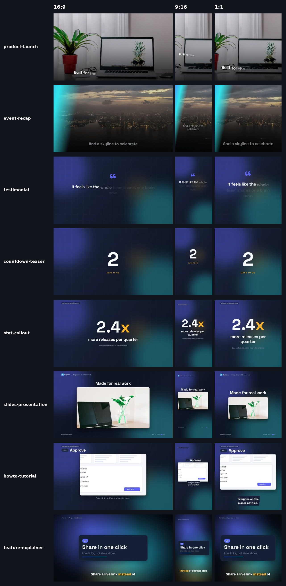
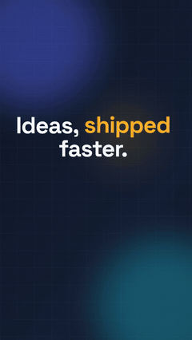
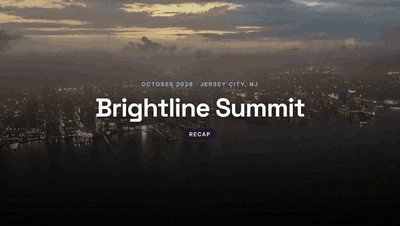
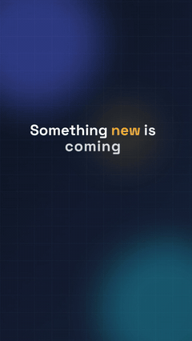
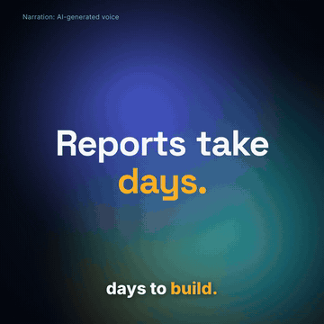
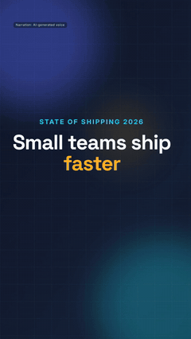
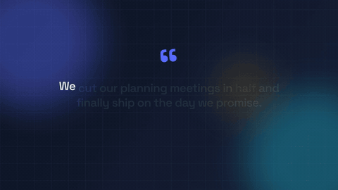
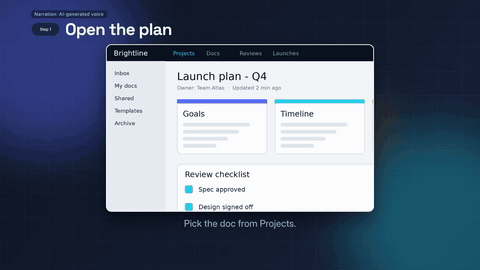
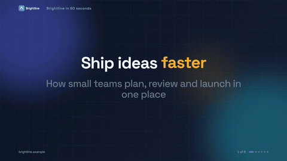

# Reelsmith v5.1

A video skill for coding agents. It writes the script with you, plans the cut, gets your approval, and renders
16:9, 9:16 and 1:1 videos from parameterized templates driven by your brand kit, with music on a beat grid,
captions, platform presets and a review gate before anything final or paid. It runs free and offline; optional
API keys (stock media, premium voice, AI generation) switch extra features on when they are present.
Every example was rendered end to end on Linux before packaging.

## Examples

| | | | |
|---|---|---|---|
|  <b>product-launch</b> · 9:16 · 20 s |  <b>event-recap</b> · 16:9 · 18 s |  <b>countdown-teaser</b> · 9:16 · 17 s |  <b>feature-explainer</b> · 1:1 · 24 s |
|  <b>stat-callout</b> · 9:16 · 21 s |  <b>testimonial</b> · 16:9 · 25 s |  <b>howto-tutorial</b> · 16:9 · 28 s |  <b>slides-presentation</b> · 16:9 · 30 s |

Click a preview to open the full MP4 (with sound). All of these were rendered by the skill on a standard Linux box with free tools and free assets; music, image and voice credits are in [examples/CREDITS.md](examples/CREDITS.md).

## What's inside
- `SKILL.md`: the skill (concise; routes to `references/`).
- `getting-started/SKILL.md`: first-run setup (engines, free voice, brand kit, optional keys).
- `references/`: brand kit, capabilities and keys, templates, scriptwriting, voiceover, music, stock media,
  captions, platform specs, loudness and accessibility, motion design (showreel kinetic type, taste numbers, and motion grammar), kinetic type recipes,
  transitions, music (beat grid, cue sheet, launch sync taps and bed-relative levels), review and QA, YouTube publishing, HyperFrames (harness: reference, then data, then motion), Remotion, AI generation (quotes only), helpers,
  client sizzle, brand QA, storyboard (the frame-numbered BRIEF). House launch recipes live in `references/templates.md`.
- `scripts/`: `capabilities.py`, `brand.py`, `reelsmith.py`, `script_lint.py`, `beats.py`, `stock.py`, `captions.py`,
  `review.py`, `export.py`, `youtube_prep.py`, `presets.json`. Python 3.10+ standard library; Pillow and librosa optional.
- `templates/`: product-launch, event-recap, testimonial, countdown-teaser, stat-callout, slides-presentation
  (kiosk loop), howto-tutorial (HyperFrames), feature-explainer (Remotion). Each has a working `sample.json`.
  `_media/` holds free placeholder images (credited).
- `brand/`: `brand.schema.json` and a fictional sample brand (logo, mark).
- `assets/music/`: a CC BY 3.0 track (Kevin MacLeod, "Militaire Electronic") with its beat grid and credits.
- `guides/`: safe-zone overlay PNGs per platform.
- `remotion-starter-kit.tgz`: complete Remotion 4 project (brand-driven theme, captions, free/paid VO script).
- `hyperframes-example/`, `manim-example/`, `lottie-example/`: small starting points.
- Awards and partner cuts: start with `references/client-sizzle.md` and a storyboard (`references/storyboard.md`, pattern in `examples/storyboard/`).

## Install
**Grok Bot:** ask your bot: "Download https://github.com/thecgaigroup/reelsmith/archive/refs/heads/main.zip, unzip it so its
contents are at `/workspace/reelsmith/` (the archive's top folder is `reelsmith-main/`), save `SKILL.md` as a skill named
Reelsmith and `getting-started/SKILL.md` as its getting-started skill, then run the getting-started steps once"
(about 10 minutes, mostly downloads). Then ask for a video, for example: "Make a 20-second launch reel for my app in
9:16 and 16:9 with music."

**Other coding agents:** `git clone https://github.com/thecgaigroup/reelsmith.git` into your skills directory
(for example `.cursor/skills/reelsmith` or `~/.claude/skills/reelsmith`).

## Roadmap
Showreel kinetic type, transitions, and an open storyboard are in the skill. An optional SageCut measurement ladder and an optional `poster-grid` recipe are documented; Sage API spend stays parked. Motion grammar, the independent-critic loop, and optional product-hero notes from [motion-video-kit](https://github.com/echris6/motion-video-kit) (MIT) are in the skill. That fold adds no Three.js package. Pricing templates from that kit stay parked. Launch-film sound (sync taps, bed-relative levels, a role bank, a measured SFX check) and a six-station harness (reference, data, story, frames, a one-line timing fix, then the master) are in the skill as of 2026-10-27. That fold adds no sound bank and no Remotion skill tree. v5.1 is that craft-docs surface, already on main. Pack behavior is unchanged. Other parked fold-ins and skips (MotionVideo paid pack, FilmCraft, CapCut, snapcn Pro, 3D/extrude and glitch defaults) are in [ROADMAP.md](ROADMAP.md). No sidecar packages.

## Notes
- Needs ffmpeg and Node 22.12+ (HyperFrames). Kokoro (free local voice), librosa, Manim and WhisperX install on first use.
- Optional keys, all through your bot's secure secret prompt and never in chat: `PEXELS_API_KEY`, `PIXABAY_API_KEY`
  (free stock), `UNSPLASH_ACCESS_KEY`, `ELEVENLABS_API_KEY` + `TTS_VOICE_ID`, `OPENAI_API_KEY`, AWS (Polly), `FAL_KEY`,
  `HIGGSFIELD_API_KEY`. `python3 scripts/capabilities.py` shows what is on.
- Paid services are never used without a quote and your OK. Nothing is uploaded or posted for you.
- Licenses: HyperFrames Apache-2.0; Remotion free for individuals and teams of up to 3 (remotion.pro/license);
  Manim and lottie-web MIT. Bundled music CC BY 3.0 (credit required; see `assets/music/CREDITS.txt`).

## License
Code and docs: MIT (see `LICENSE`). Bundled third-party media and music keep their own licenses (CC0 / CC BY), listed in
their credits files. Remotion has its own license: free for individuals and teams of up to 3, companies need a
company license (remotion.pro/license).
