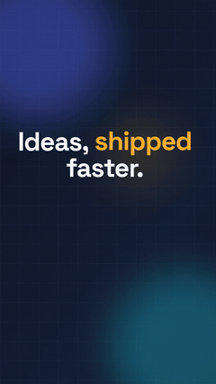
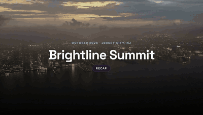
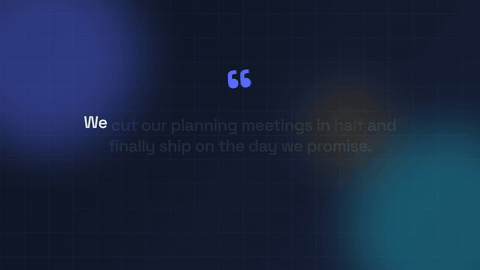
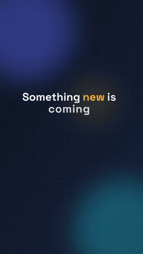
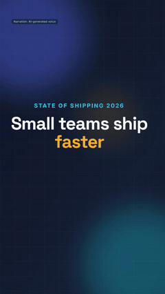
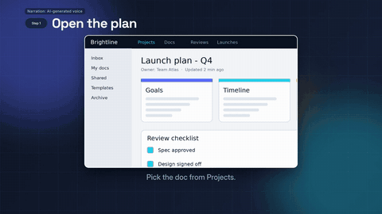
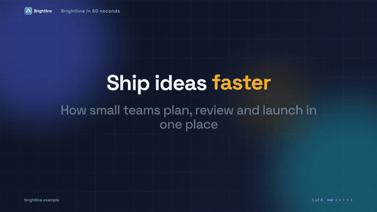
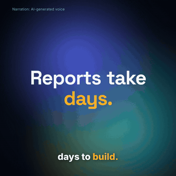
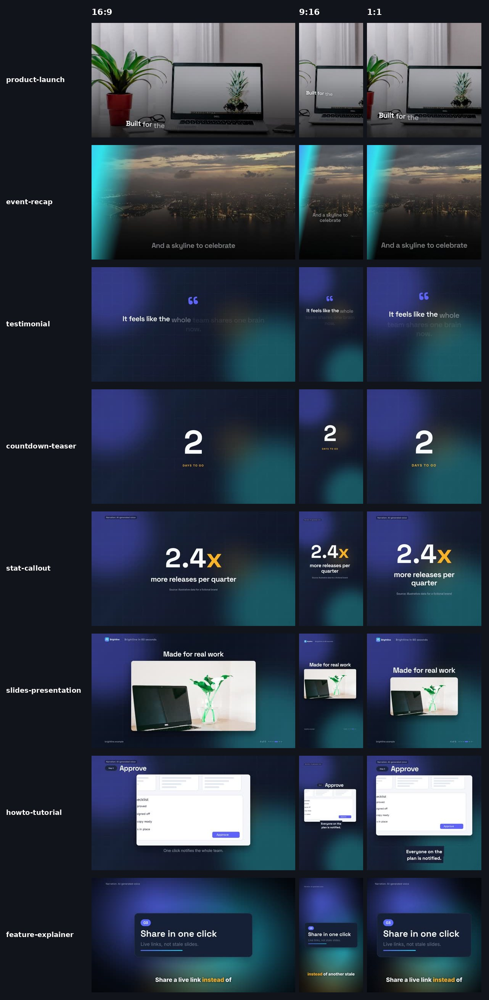

# Reelsmith v5.4.0

A video skill for coding agents. It writes the script with you, plans the cut, gets your approval, and renders
16:9, 9:16 and 1:1 videos from parameterized templates driven by your brand kit, with music on a beat grid,
captions, platform presets and a review gate before anything final or paid. It runs free and offline; optional
API keys (stock media, premium voice, AI generation) switch extra features on when they are present.
Every example was rendered end to end on Linux before packaging.

## What Reelsmith makes

| Capability | Example |
|---|---|
| **Product launches and feature promos** — Music-driven announcement videos with kinetic type and brand animations |  |
| **Event recaps and highlights** — Turn event photos into engaging video recaps with music and transitions |  |
| **Testimonials and customer stories** — Showcase customer quotes and reviews with polished typography |  |
| **Coming soon teasers** — Countdown and date-reveal videos with loopable animations |  |
| **Stats and milestone callouts** — Highlight key numbers, metrics, and achievements |  |
| **Tutorials and how-tos** — Step-by-step instructional videos with chapter markers for YouTube |  |
| **Slide presentations and kiosk loops** — Animated decks for talks, booths, or continuous display |  |
| **Feature explainers with narration** — Product walkthroughs with voiceover and auto-generated captions |  |
| **Client sizzle reels and awards cuts** — Production-quality cuts from real footage with beat-synced kinetic type | See references/client-sizzle.md |

Everything works free and offline. Optional API keys add features: a **Pexels** key unlocks high-quality stock photos and videos. Run `python3 scripts/capabilities.py` to see what's available.

## Examples



| | | | |
|---|---|---|---|
| <a href="examples/product-launch-9x16.mp4"></a><br><b>product-launch</b> · 9:16 · 20 s | <a href="examples/event-recap-16x9.mp4"></a><br><b>event-recap</b> · 16:9 · 18 s | <a href="examples/countdown-teaser-9x16.mp4"></a><br><b>countdown-teaser</b> · 9:16 · 17 s | <a href="examples/feature-explainer-1x1.mp4"></a><br><b>feature-explainer</b> · 1:1 · 24 s |
| <a href="examples/stat-callout-9x16.mp4"></a><br><b>stat-callout</b> · 9:16 · 21 s | <a href="examples/testimonial-16x9.mp4"></a><br><b>testimonial</b> · 16:9 · 25 s | <a href="examples/howto-tutorial-16x9.mp4"></a><br><b>howto-tutorial</b> · 16:9 · 28 s | <a href="examples/slides-presentation-16x9.mp4"></a><br><b>slides-presentation</b> · 16:9 · 30 s |

Click a preview to open the full MP4 (with sound). All of these were rendered by the skill on a standard Linux box with free tools and free assets; music, image and voice credits are in [examples/CREDITS.md](examples/CREDITS.md).

## What's inside
- `SKILL.md`: the skill (concise; routes to `references/`).
- `getting-started/SKILL.md`: first-run setup (engines, free voice, brand kit, optional keys).
- `references/`: brand kit, capabilities and keys, templates, scriptwriting, voiceover, music, stock media,
  captions, platform specs, loudness and accessibility, motion design (showreel kinetic type, taste numbers, and motion grammar), kinetic type recipes,
  transitions, music (beat grid, cue sheet, launch sync taps and bed-relative levels), review and QA, YouTube publishing, HyperFrames (harness: reference, then data, then motion), Remotion, AI generation (quotes only), helpers,
  client sizzle, brand QA, storyboard (the frame-numbered BRIEF). House launch recipes live in `references/templates.md`.
- `scripts/`: `capabilities.py`, `brand.py`, `reelsmith.py`, `script_lint.py`, `beats.py`, `stock.py`, `captions.py`,
  `review.py`, `export.py`, `youtube_prep.py`, `presets.json`. Python 3.10+ standard library; Pillow and librosa optional.
- `templates/`: product-launch, event-recap, testimonial, countdown-teaser, stat-callout, slides-presentation
  (kiosk loop), howto-tutorial (HyperFrames), feature-explainer (Remotion). Each has a working `sample.json`.
  `_media/` holds free placeholder images (credited).
- `brand/`: `brand.schema.json` and a fictional sample brand (logo, mark).
- `assets/music/`: a CC BY 3.0 track (Kevin MacLeod, "Militaire Electronic") with its beat grid and credits.
- `guides/`: safe-zone overlay PNGs per platform.
- Remotion starter kit: complete Remotion 4 project (brand-driven theme, captions, free/paid VO script). `remotion-starter-kit.tgz` is not in the current tree (`*.tgz` is gitignored). History was not rewritten, so the archive is still in past commits.
- `hyperframes-example/`, `openmotion-example/`, `manim-example/`, `lottie-example/`: small starting points.
- Awards and partner cuts: start with `references/client-sizzle.md` and a storyboard (`references/storyboard.md`, pattern in `examples/storyboard/`).

## Install
**Grok Bot:** ask your bot: "Download https://github.com/thecgaigroup/reelsmith/archive/refs/heads/main.zip, unzip it so its
contents are at `/workspace/reelsmith/` (the archive's top folder is `reelsmith-main/`), save `SKILL.md` as a skill named
Reelsmith and `getting-started/SKILL.md` as its getting-started skill, then run the getting-started steps once"
(about 10 minutes, mostly downloads). Then ask for a video, for example: "Make a 20-second launch reel for my app in
9:16 and 16:9 with music."

**Other coding agents:** `git clone https://github.com/thecgaigroup/reelsmith.git` into your skills directory
(for example `.cursor/skills/reelsmith` or `~/.claude/skills/reelsmith`).

## When to use the clipping lane

**v5.4.0 adds a long-form to vertical 9:16 clipping lane** for extracting highlight moments from local videos.

**Use the clipping lane for:**
- Talking-head content (interviews, vlogs, tutorials, presentations) where you want to extract 10-60 second highlights
- Local video files you own or have rights to use
- Vertical (9:16) clips for Reels, Shorts, TikTok with face-tracked reframing

**Do not use the clipping lane for:**
- Music videos or performance footage (no face to track)
- Multi-speaker content with frequent speaker changes
- YouTube downloads (local files only; no downloader shipped)
- Template-driven content (use product-launch, testimonial, etc. instead)
- Client sizzles from real footage (use client-sizzle.md workflow instead)

See `references/clipping.md` for the complete workflow, face tracking approach, highlight scoring (CPU-only, $0, no LLM), and limitations.


## Stream-Highlights Mode (v5.5.0)

Turn live streams or VODs into vertical 9:16 highlight clips. Finds high-engagement moments from chat activity bursts, audio energy, or speech patterns.

### What it does

- **Input**: Local video file OR stream URL (YouTube, Twitch) with `--rights-confirmed`
- **Chat sources**: Twitch IRC, YouTube live chat (requires API keys), or chat.json file
- **Moment detection**: Three-tier priority system:
  1. **Chat bursts** (highest): Spikes in viewer reactions and engagement
  2. **RMS loudness**: Dynamic audio moments when chat unavailable
  3. **Speech-lexicon** (optional): Speech pattern analysis via faster-whisper
- **Smart crop**: Facecam-aware 9:16 crop keeps the facecam OUT of frame
  - YuNet face detection (MIT License, optional model download)
  - YOLOX-S person tracking for player-follow pan (Apache-2.0, optional)
  - Falls back to OpenCV Haar cascade (no models required)
- **6-second lead-in**: Clips start 6s before peak moment for context
- **Stream-pop captions**: 3-word pop-in captions (yellow new words, white spoken)
- **Profanity masking**: Masks explicit words in burned-in captions (audio unchanged)

### Install

**Core dependencies** (already included):
```bash
pip install opencv-python pysubs2
```

**Stream-highlights dependencies** (optional, for URL input and advanced features):
```bash
pip install -r requirements-stream.txt
```

This installs:
- `yt-dlp`: URL input for live streams and VODs
- `faster-whisper`: Speech-lexicon fallback
- `onnxruntime`: ONNX model inference for YuNet/YOLOX

**Download models** (optional, for YuNet/YOLOX detection):
```bash
python3 scripts/fetch_models.py --all
```

Models (with SHA-256 verification):
- **YuNet** (face detection, MIT License): 233 KB
- **YOLOX-S** (person tracking, Apache-2.0): 35 MB

Without models, stream-highlights mode falls back to OpenCV Haar cascade (no downloads).

### Usage

**Local file with chat.json:**
```bash
python3 scripts/clipping.py process video.mp4 \
  --out output/clips \
  --mode stream-highlights \
  --chat chat.json \
  --min-clip 10 \
  --max-clip 30 \
  --top-n 5
```

**Stream URL (requires `--rights-confirmed`):**
```bash
python3 scripts/clipping.py process "https://www.youtube.com/watch?v=VIDEO_ID" \
  --out output/clips \
  --mode stream-highlights \
  --rights-confirmed \
  --min-clip 10 \
  --max-clip 30 \
  --top-n 5
```

**With live chat collection** (requires `YOUTUBE_API_KEY` or Twitch credentials):
```bash
export YOUTUBE_API_KEY="your_key_here"

python3 scripts/clipping.py process "https://www.youtube.com/watch?v=VIDEO_ID" \
  --out output/clips \
  --mode stream-highlights \
  --rights-confirmed \
  --chat live
```

### Chat.json format

Supports Twitch IRC logs and YouTube chat exports:
```json
[
  {"t": 10.5, "user": "username", "text": "amazing clip!"},
  {"t": 11.0, "user": "viewer2", "text": "wow insane"}
]
```

Alternate formats auto-normalized:
- `time`/`timestamp` → `t`
- `username`/`author` → `user`
- `message`/`content` → `text`

### How moments are picked

**Priority 1: Chat bursts** (if chat available)
- Analyzes message density, unique participants, excitement markers
- Deweights spam: one user repeating a message doesn't inflate score
- Uses Median Absolute Deviation (MAD) for outlier-robust scoring
- Finds peak 5-second bucket for precise clip start

**Priority 2: RMS loudness** (always available)
- Analyzes audio energy in 2-second windows
- Identifies dynamic/loud moments
- CPU-only via ffmpeg volumedetect

**Priority 3: Speech-lexicon** (optional, requires faster-whisper)
- Transcribes speech and analyzes reaction patterns
- Enabled with `--speech-fallback` flag
- Falls back when chat unavailable and RMS insufficient

### Rights and platform notes

**You are responsible for:**
- Obtaining rights and permissions to record, edit, and publish content
- Respecting platform terms of service
- Complying with content creator policies

The `--rights-confirmed` flag is required for all URL inputs. It confirms you have verified you have the necessary rights before processing begins.

### See also

- [references/clipping.md](references/clipping.md) — Full clipping lane documentation
- [SKILL.md](SKILL.md) — Main skill for template-driven videos
- [examples/](examples/) — Gallery of template examples

## Roadmap
Showreel kinetic type, transitions, and an open storyboard are in the skill. An optional SageCut measurement ladder and an optional `poster-grid` recipe are documented; Sage API spend stays parked. Motion grammar, the independent-critic loop, and optional product-hero notes from [motion-video-kit](https://github.com/echris6/motion-video-kit) (MIT) are in the skill. That fold adds no Three.js package. Pricing templates from that kit stay parked. Launch-film sound (sync taps, bed-relative levels, a role bank, a measured SFX check) and a six-station harness (reference, data, story, frames, a one-line timing fix, then the master) are in the skill as of 2026-10-27. That fold adds no sound bank and no Remotion skill tree. v5.1 is that craft-docs surface, already on main. Pack behavior is unchanged. Other parked fold-ins and skips (MotionVideo paid pack, FilmCraft, CapCut, snapcn Pro, 3D/extrude and glitch defaults) are in [ROADMAP.md](ROADMAP.md). No sidecar packages.

## Notes
- Needs ffmpeg and Node 22.12+ (HyperFrames). Kokoro (free local voice), librosa, Manim and WhisperX install on first use.
- Optional keys, all through your bot's secure secret prompt and never in chat: `PEXELS_API_KEY`, `PIXABAY_API_KEY`
  (free stock), `UNSPLASH_ACCESS_KEY`, `ELEVENLABS_API_KEY` + `TTS_VOICE_ID`, `OPENAI_API_KEY`, AWS (Polly), `FAL_KEY`,
  `HIGGSFIELD_API_KEY`. `python3 scripts/capabilities.py` shows what is on.
- Paid services are never used without a quote and your OK. Nothing is uploaded or posted for you.
- Licenses: HyperFrames Apache-2.0; Remotion free for individuals and teams of up to 3 (remotion.pro/license);
  Manim and lottie-web MIT. Bundled music CC BY 3.0 (credit required; see `assets/music/CREDITS.txt`).

## Dependency updates
Dependabot opens weekly PRs (Mondays): minor+patch grouped per ecosystem, majors one-per-PR, security fixes separately.
Lovit reviews and merges green minor/patch groups; any major (label it "major, needs Marc") or anything touching deploy files or Ignition-live waits for Marc.
Intentional pins are ignored in .github/dependabot.yml (Codex 0.160.1 / @openai/codex*, Hermes 0.22.4, plus repo-specific tested pins) - do not bump them in a dependency PR.
Dependency PRs use CI minutes; keep open PRs low and close stale ones rather than rebasing them repeatedly.

## License
Code and docs: MIT (see `LICENSE`). Bundled third-party media and music keep their own licenses (CC0 / CC BY), listed in
their credits files. Remotion has its own license: free for individuals and teams of up to 3, companies need a
company license (remotion.pro/license).
